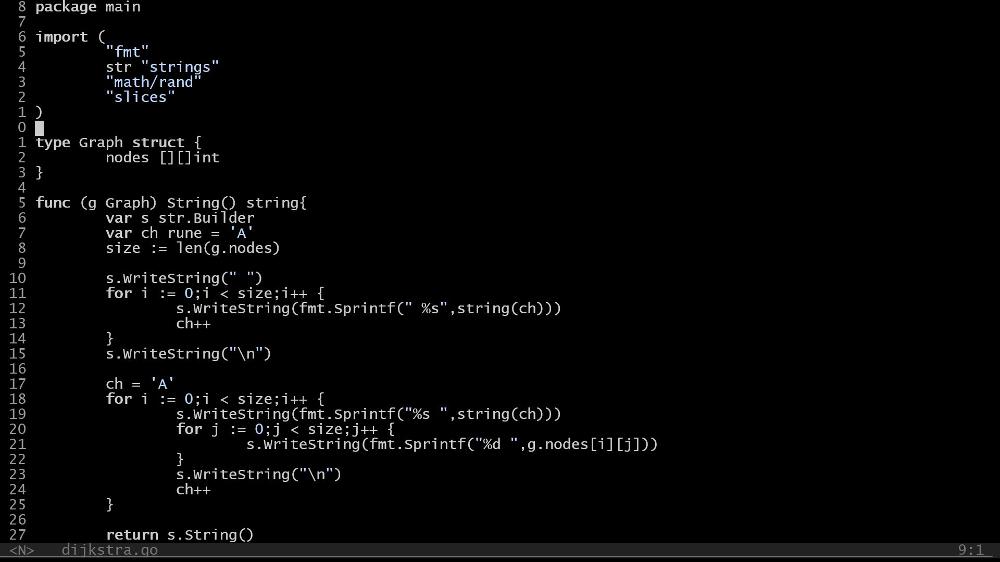
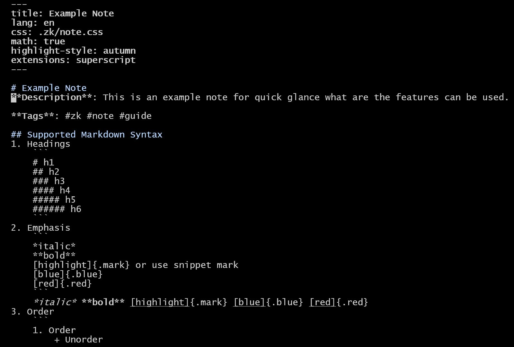
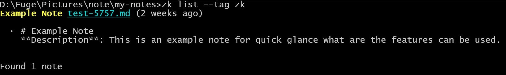
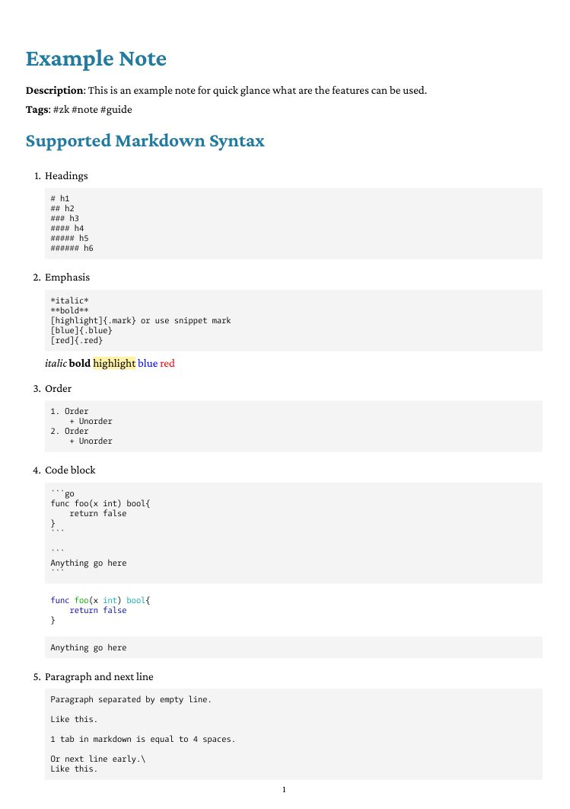
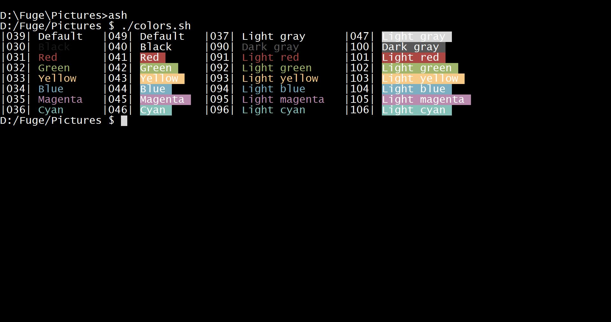

# fuge dotfiles
1. nvim (text editor)
    + Intent to use with neovide or alacritty on Windows
    + `markdown_inline.json` could be a symlink to `markdown.json` in snippets folder

    

    *[Minimal theme](https://github.com/andreypopp/vim-colors-plain) with Lucida Console font in Neovide*

2. zk (knowledge management)
    + A [default](https://github.com/Fuge8766/dotfiles/blob/main/zk/templates/default.md) note and a [journal](https://github.com/Fuge8766/dotfiles/blob/main/zk/templates/journal.md) note type
    + Default markdown note is ready to be compiled to pdf by [glu](https://boxesandglue.dev/glu/) with style in `note.css` and math support
    + Custom syntax (yellow highlight, blue and red text), codes with [syntax highlight](https://xyproto.github.io/splash/docs/autumn.html), direct qr code generation and external lua support for greater control

    

    *Note layout*

    

    *When listing the notes with zk, the title and description show in lines*

    

    *Generate pdf from note*

3. alacritty (terminal emulator)
    + Config specific for Windows
    
    

    *[Clean](https://github.com/alacritty/alacritty-theme/blob/master/themes/base16_default_dark.toml) terminal setup*
